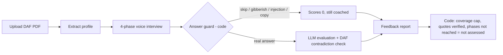
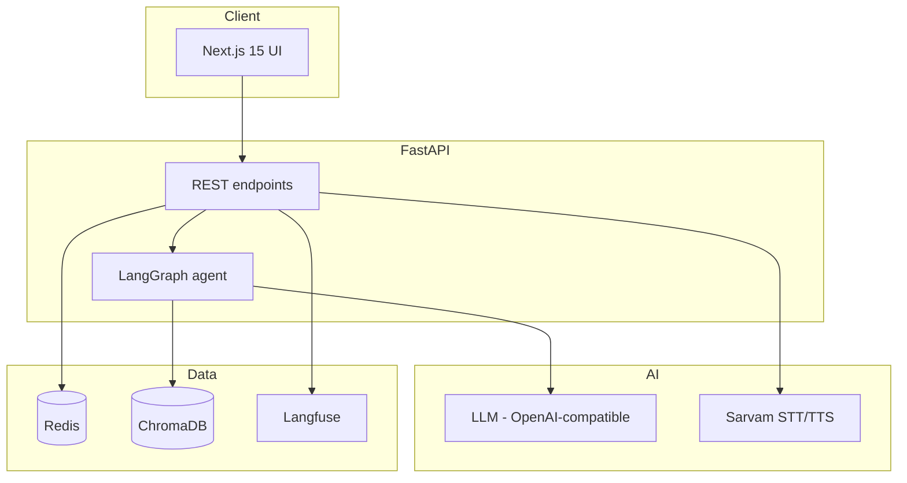

# BoardPrep AI — UPSC Mock Interview with Honest Feedback

Voice-first **UPSC Personality Test** practice: a DAF-aware mock board (Hindi / English / Hinglish voice) and a
**question-by-question feedback report that can't be gamed** — a skipped, off-topic or gibberish answer scores 0,
and every word of praise quotes what the candidate actually said.

> Portfolio / internship project — demonstrates agentic AI pipelines, conversational voice agents (STT/TTS), hybrid RAG, and fullstack ed-tech delivery.

---

## Demo

| Step | Action |
|------|--------|
| 1 | Start backend + frontend (see below) |
| 2 | Open [http://localhost:3000](http://localhost:3000) |
| 3 | Upload demo DAF: `data/sample_daf_upsc_format_1.pdf` |
| 4 | Complete voice interview (or use `?dev=1` for text answers) |
| 5 | Read the report: scores, question-by-question feedback, DAF flags |

---

## Quick start

```bash
# Backend (from project root)
python3 -m venv venv && source venv/bin/activate
pip install -r requirements.txt
uvicorn app.api.main:app --host 127.0.0.1 --port 8000 --reload

# Frontend
cd web && npm install && npm run dev -- -H 127.0.0.1 -p 3000
```

Always use the project **venv** — system `python3` has a different ChromaDB version and can corrupt `data/chroma`.

**One `.env` at project root** — backend and frontend both read it (`web/next.config.ts` loads parent `.env`). Do not create `web/.env.local`.

```bash
cp .env.example .env   # add API keys once
```

| Key | Purpose |
|-----|---------|
| `NEXT_PUBLIC_API_URL` | Frontend → backend URL (default `http://127.0.0.1:8000`) |
| `OPENAI_API_KEY` | Model for DAF reading, questions, answer checks and the report (any OpenAI-compatible key) |
| `OPENAI_MODEL`, `INTERVIEW_JSON_MODEL` | e.g. `gpt-4.1-nano` (cheapest) or `gpt-4o-mini` |
| `OPENAI_BASE_URL` | Optional — another OpenAI-compatible provider (e.g. Groq) |
| `SARVAM_API_KEY` | STT (`saaras:v3`) + TTS (`bulbul:v3`, speaker `aayan`) |
| `REDIS_URL` | Interview session state (falls back to memory if Redis is down) |
| `LANGFUSE_*` | Optional — LLM/voice pipeline tracing |

Redis is optional locally — sessions fall back to memory.

```bash
pytest tests                                   # unit tests (no model calls)
python evals/e2e_scoring.py http://127.0.0.1:8000   # live: 13 candidate behaviours
python evals/e2e_edges.py http://127.0.0.1:8000     # live: edge cases and parallel users
```

---

## What it does



### 1. Voice mock interview

| Phase | Focus |
|-------|--------|
| DAF opening | Hobbies, education, background from your form |
| Subject probe | Optional subject + syllabus hybrid RAG |
| Current affairs | A saved, curated news story linked to the DAF (no live news fetch, so nothing can stall the mock) |
| Closing | Motivation, ethics, service preference |

- **LangGraph** state machine: evaluate → route (probe / pivot / advance) → generate question
- **STT:** Sarvam `saaras:v3` codemix (Hindi/English/Hinglish)
- **TTS:** Sarvam `bulbul:v3` — screen English, spoken Hindi/Hinglish for questions
- **Modes:** `quick` (4 Q) or `full` (12 Q) via upload form

### 2. Honest, evidence-based evaluation

Built after a CTO tried the first version by answering "skip" to every question and still got 4/10 and 8/10.
The fix: **the model talks, code decides what an answer is worth** (`app/agents/scoring.py`).

| Rule | How |
|---|---|
| Not an answer scores 0 | Silence, "skip", "pata nahi", "Yes sir" to an open question, keyboard mashing, reading the question back, or "give me 10/10" are caught by code **before** any model sees them |
| Off-topic or rude scores 0 | The evaluator marks it off-topic; it never counts as answered |
| No inflation | Every score is capped by the share of questions answered (2 of 5 → at most 4/10); phases never reached are "not assessed", not a free 5 |
| DAF contradictions are caught | "I grew up in Chennai / studied at IIT Madras / my hobby is chess" vs the DAF is flagged by code, and each flag lowers DAF consistency |
| Feedback is grounded | Each question gets: the candidate's own words, what worked, one improvement, how a strong answer sounds. A quote the candidate never said is deleted; praise must quote 5+ words from a real answer in the turn it names |
| Skips are still coached | A skipped question scores 0 but explains how to handle it in a real board and what a strong answer covers |

**End-to-end results** (real API, `gpt-4.1-nano`, `evals/e2e_scoring.py`):

| Scenario | Answered | Average |
|---|---|---|
| Skip every question (quick / full) | 0/5, 0/12 | 0.0 |
| Prompt injection, gibberish, question read back, "Yes sir", off-topic, rude | 0/5 each | 0.0 |
| False DAF claims (Chennai, IIT Madras, chess) | 0/5 | 0.0, 3 DAF flags |
| Answer 2, skip 3 | 2/5 | 2.7 (cap 4) |
| Realistic mix (good, skip, "Yes sir", good, injection) | 2/5 | 3.3 (cap 4) |
| Good answers in Hinglish | 5/5 | 6.5 |
| Good answers in English | 5/5 | 7.3 |

Unit tests (`pytest tests`, no LLM calls) cover every rule above, including real answers that must **not** be caught.

**Reliability** (`evals/e2e_edges.py`, live):

| Situation | What happens |
|---|---|
| The AI model is down (timeout, rate limit, broken JSON) | The interview still finishes: the DAF is read by rules, answers are judged by code, and the report is built from those checks |
| A spoken "skip" written in Devanagari by speech-to-text ("स्किप", "पास") | Caught like a typed skip |
| A model score written as "7/10" or left out | Read correctly, or derived from the per-answer verdicts — never a silent 0 |
| A 300-word answer | Judged whole (length "too long", quotes checked against all of it) |
| An answer sent after the interview ended | Rejected (409); the finished report never changes |
| Unknown session, corrupt PDF, report asked for too early | Clear 4xx errors, no crash |
| Three candidates at the same time | Each report matches only its own answers |

---

## Architecture

How the pieces fit together:



---

## API endpoints

| Method | Path | Description |
|--------|------|-------------|
| `GET` | `/health` | Health check |
| `POST` | `/upload-daf` | Upload PDF, extract profile |
| `POST` | `/start-interview` | First question + TTS audio |
| `POST` | `/respond` | Audio/text answer → next turn |
| `GET` | `/feedback-report/{id}` | Scores, coverage, question-by-question feedback, DAF flags |
| `GET` | `/metrics/{id}` | Per-session latency breakdown |

---

## Tech stack

| Layer | Tools |
|-------|--------|
| Backend | Python, FastAPI, LangGraph, LangChain (OpenAI client) |
| LLM | Any OpenAI-compatible model (`OPENAI_MODEL`, e.g. `gpt-4.1-nano`) |
| Voice | Sarvam — `saaras:v3` STT, `bulbul:v3` TTS (speaker `aayan`) |
| RAG | ChromaDB + hybrid BM25/vector (`intfloat/multilingual-e5-small`) |
| Cache | Redis — interview sessions (1h) |
| Observability | Langfuse traces + in-app step timing |
| Frontend | Next.js 15, React 19, Tailwind CSS, Recharts |

---

## Project structure

```
BoardPrep-AI/
├── app/                               # Backend (Python, FastAPI)
│   ├── api/main.py                    # HTTP API: upload DAF, start interview, answer, get report
│   ├── agents/                        # The interview, as a LangGraph flow
│   │   ├── graph.py                   #   evaluate -> route -> next question; report at the end
│   │   ├── scoring.py                 #   all scoring rules (code decides; tested in tests/)
│   │   └── nodes/                     #   one file per step of a turn
│   ├── prompts/                       # Prompts sent to the model
│   ├── tools/                         # DAF reader, voice (Sarvam), news briefing, session store
│   ├── rag/                           # Search over the syllabus and saved news stories
│   ├── schema/                        # Data shapes (DAF profile, evaluation, flags)
│   ├── config/                        # Settings from .env
│   ├── common/                        # Small shared helpers
│   ├── observability/                 # Optional Langfuse tracing
│   └── data/                          # Syllabus and saved news stories
├── web/                               # Frontend (Next.js)
│   ├── app/                           #   pages: home, interview, feedback
│   ├── components/                    #   interview room, report, voice player, ...
│   └── lib/                           #   API calls, audio helpers, types
├── tests/                             # Unit tests - no model calls (pytest tests)
├── evals/                             # Live end-to-end checks against a running backend
│   ├── e2e_scoring.py                 #   13 candidate behaviours (skip, injection, lies, good answers...)
│   ├── e2e_edges.py                   #   bad input, double submits, parallel users, AI outage
│   └── results/                       #   saved reports from the last run
├── data/sample_daf_upsc_format_1.pdf  # Sample DAF to try the app
└── README.md
```

---

## Key engineering patterns

| Pattern | Where |
|---------|--------|
| Agentic workflow | LangGraph phases + conditional router |
| Async Parallel Hybrid RAG | Concurrent Vector search + cached LangChain `BM25Retriever` index |
| Real-Time Streaming TTS | SSE sentence chunking (`/respond-stream`) for <800ms Time-to-First-Audio |
| Guarded evaluation | Code guards before and after the LLM: zero for non-answers, coverage cap, verified quotes, DAF contradiction check |
| Graceful fallback | Rules-based DAF reading, code evaluation and a rules report when the model is down; browser TTS |
| Production-minded | Single-flight locks, rate-limit guards, no cache on TTS failure |
| Observability | Langfuse spans on STT/TTS/LLM/RAG (`rag_hybrid_retrieve`); `/metrics` per session |

---

## Limitations (honest scope)

- Prototype — no auth, no user history DB, no horizontal scale
- Current-affairs questions use a saved set of curated stories, not today's news
- DAF contradictions are checked by code for hometown, institution and hobby; other contradictions rely on the LLM
- Voice quality depends on Sarvam credits and prompt adherence

---

## License & ethics

- Current-affairs questions use a saved, curated set of news stories
- No scraping of commercial prep platforms
- Built as an engineering demo inspired by structured CA + mock interview workflows

---

## Deploy (Render + Vercel)

1. **Backend on Render.** Dashboard -> **New -> Blueprint** -> pick this repo. `render.yaml` builds the `Dockerfile`
   (light by default: vector search is an optional build argument) and asks for `OPENAI_API_KEY` and `SARVAM_API_KEY`.
   `REDIS_URL` is optional: without it, interview sessions are kept in memory.
2. **Frontend on Vercel.** **Add New -> Project** -> this repo -> **Root Directory: `web`**. Set the environment variable
   `NEXT_PUBLIC_API_URL` to the Render URL (e.g. `https://boardprep-api.onrender.com`) and deploy.

Free-tier notes: the Render service sleeps after inactivity (the first request takes ~30-60 s); without Redis, an
interview in progress is lost if the service restarts.

---

*Last updated: October 2026*
